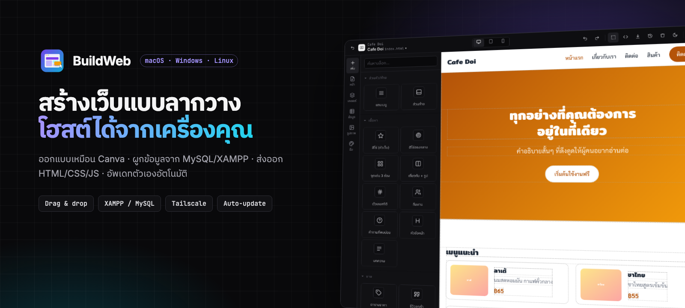

# ดาวน์โหลด BuildWeb

| ระบบ | ดาวน์โหลด |
|---|---|
| **macOS** (Apple M1–M4) |  |
| **macOS** (Intel) |  |
| **Windows** 10/11 (64-bit) |  |
| **Linux** (x86_64) |   |

**ติดตั้งครั้งแรก**
- **macOS:** เปิด `.dmg` แล้วลาก BuildWeb ไปไว้ใน Applications · ถ้าเปิดไม่ได้ ไปที่ System Settings › Privacy & Security › **Open Anyway**
- **Windows:** ถ้า SmartScreen เตือน ให้กด **More info › Run anyway**
- **Linux:** `chmod +x BuildWeb.AppImage && ./BuildWeb.AppImage` หรือ `sudo apt install ./BuildWeb.deb`

**อัพเดทอัตโนมัติ:** แอปตรวจและติดตั้งเวอร์ชันใหม่จาก repo นี้เอง ข้อมูลเว็บของคุณไม่หาย

ฟีเจอร์และโค้ด: **[AImunich20/BuildWeb](https://github.com/AImunich20/BuildWeb)** · ประวัติเวอร์ชัน: [Releases](https://github.com/AImunich20/buildweb-releases/releases)
